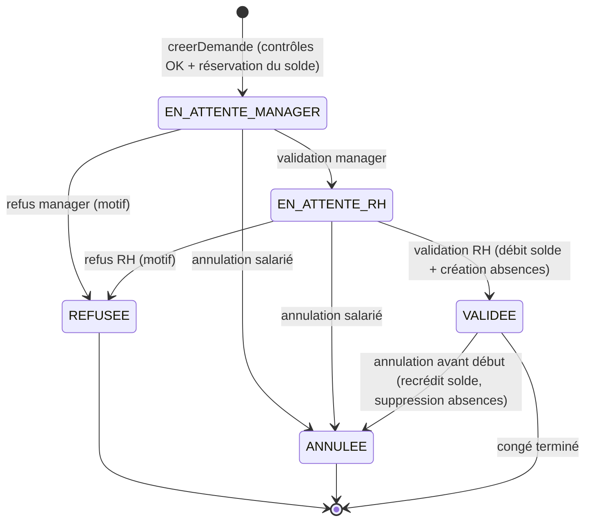

# TODO — Bloc 7 : Congés et absences

**Flux global** : Demande de congé → contrôle du solde → validation manager / RH → mise à jour du planning et des variables de paie.

**Principe d'architecture**
- **Base de données (PostgreSQL)** : uniquement des **tables**, des **contraintes déclaratives** (PK, FK, UNIQUE, CHECK simples), des **index** et des **vues**. Aucune fonction SQL, aucun trigger.
- **Application (CodeIgniter 4)** : toute la logique (calculs, contrôles, workflow, soldes, audit, notifications) est dans des **services PHP**.

> Adapte les noms `salarie`, `contrat`, `service`, etc. à ton modèle existant.

---

## 0. Ordre de réalisation

- [x] 1. Tables de référence (types, statuts, jours fériés)
- [x] 2. Tables métier (droits, soldes, demandes, absences, justificatifs, mouvements)
- [x] 3. Contraintes et index
- [x] 4. Vues
- [x] 5. Models CodeIgniter (un par table)
- [x] 6. Services PHP (calendrier, solde, contrôle, workflow, absences, paie)
- [x] 7. Controllers + routes API
- [ ] 8. Commandes planifiées (`php spark`)
- [ ] 9. Écrans
- [ ] 10. Jeux de données et tests (un par cas de la section 6)

---

## 1. Base de données (tables seulement)

### 1.1 Tables de référence

- [x] **`type_conge`**
  - `id_type_conge` bigserial PK
  - `code` varchar(20) UNIQUE (ANNUEL, MALADIE, MATERNITE, PATERNITE, SANS_SOLDE, FAMILIAL, FORMATION, RECUP)
  - `libelle` varchar(100)
  - `est_paye` boolean : le congé est-il rémunéré
  - `deduit_solde` boolean : débite-t-il un solde
  - `justificatif_requis` boolean
  - `delai_prevenance_jours` int DEFAULT 0
  - `duree_max_jours` numeric(5,2) NULL
  - `demi_journee_autorisee` boolean
  - `actif` boolean DEFAULT true

- [x] **`statut_demande_conge`** (même logique que tes autres tables de statuts)
  - `id_statut` bigserial PK, `code` UNIQUE, `libelle`
  - Valeurs : `EN_ATTENTE_MANAGER`, `EN_ATTENTE_RH`, `VALIDEE`, `REFUSEE`, `ANNULEE`

- [x] **`type_absence`** : `id_type_absence`, `code`, `libelle`, `retenue_paie` boolean
  - Valeurs : `CONGE`, `MALADIE`, `ABSENCE_INJUSTIFIEE`, `MISSION`, `RETARD`, `AUTORISATION`

- [x] **`jour_ferie`** : `id_jour_ferie`, `date_ferie` date, `libelle`, `recurrent` boolean

### 1.2 Tables métier

- [x] **`droit_conge`** (quota par type, historisé comme ta grille salariale)
  - `id_droit_conge` PK
  - `id_type_conge` FK
  - `id_type_contrat` FK NULL (NULL = tous les contrats)
  - `nb_jours_annuel` numeric(5,2)
  - `acquisition_mensuelle` numeric(4,2) (ex. 2,5 j/mois, à confirmer selon ton règlement interne)
  - `anciennete_min_mois` int DEFAULT 0
  - `date_debut` date, `date_fin` date NULL, `actif` boolean

- [x] **`solde_conge`**
  - `id_solde_conge` PK
  - `id_salarie` FK, `id_type_conge` FK, `annee` int
  - `droit_acquis` numeric(5,2) DEFAULT 0
  - `report` numeric(5,2) DEFAULT 0
  - `pris` numeric(5,2) DEFAULT 0 (jours validés)
  - `en_attente` numeric(5,2) DEFAULT 0 (jours réservés par des demandes non tranchées)
  - UNIQUE (`id_salarie`, `id_type_conge`, `annee`)
  - Le disponible (`droit_acquis + report - pris - en_attente`) est calculé par la vue et par `SoldeService`, pas stocké.

- [x] **`demande_conge`**
  - `id_demande_conge` PK
  - `id_salarie` FK, `id_type_conge` FK, `id_statut` FK
  - `date_debut` date, `date_fin` date
  - `demi_journee_debut` boolean DEFAULT false, `demi_journee_fin` boolean DEFAULT false
  - `nb_jours` numeric(5,2) (calculé par l'app et figé à la création)
  - `motif` text, `date_demande` timestamp DEFAULT now()
  - `id_manager_valideur` FK NULL, `date_validation_manager` timestamp NULL, `commentaire_manager` text
  - `id_rh_valideur` FK NULL, `date_validation_rh` timestamp NULL, `commentaire_rh` text
  - `motif_refus` text, `date_annulation` timestamp NULL

- [x] **`absence`** (réalité du planning : générée depuis un congé validé, ou saisie directement)
  - `id_absence` PK, `id_salarie` FK, `id_type_absence` FK
  - `id_demande_conge` FK NULL
  - `date_debut`, `date_fin`, `nb_jours`
  - `justifiee` boolean DEFAULT false
  - `commentaire`, `id_saisi_par` FK, `date_saisie`

- [x] **`justificatif_absence`** : `id_justificatif`, `id_absence` FK NULL, `id_demande_conge` FK NULL, `nom_fichier`, `chemin`, `date_depot`, `valide` boolean NULL, `id_validateur` NULL

- [x] **`mouvement_solde`** (journal des soldes, écrit par `SoldeService` à chaque changement)
  - `id_mouvement`, `id_solde_conge` FK, `id_demande_conge` FK NULL
  - `type_mouvement` : `ACQUISITION`, `RESERVATION`, `DEBIT`, `RECREDIT`, `REPORT`, `AJUSTEMENT`, `EXPIRATION`
  - `nb_jours` numeric(5,2) (signé), `date_mouvement`, `commentaire`

- [x] **`delegation_validation`** (optionnel) : `id_manager`, `id_delegue`, `date_debut`, `date_fin`

### 1.3 Contraintes et index (déclaratifs uniquement)

- [x] CHECK sur `demande_conge` : `date_fin >= date_debut` et `nb_jours > 0`
- [x] CHECK sur `solde_conge` : `droit_acquis + report - pris - en_attente >= 0` (filet de sécurité, sauf si tu autorises les avances)
- [x] UNIQUE sur `solde_conge (id_salarie, id_type_conge, annee)`
- [x] FK avec `ON DELETE RESTRICT` partout (on n'efface jamais, on annule)
- [x] Index sur `demande_conge (id_salarie, date_debut, date_fin)`, `demande_conge (id_statut)`, `absence (id_salarie, date_debut)`

---

## 2. Règles de gestion

Chaque règle indique le service PHP qui l'applique.

**Demande** (`ControleDemandeService`)
- [ ] **RG01** : seul un salarié avec un contrat **actif** peut demander un congé.
- [ ] **RG02** : `date_fin >= date_debut` ; une demi-journée n'est permise que si `demi_journee_autorisee`.
- [ ] **RG03** : `nb_jours` ne compte que les jours ouvrés (hors week-end et jours fériés), via `CalendrierService`. Règle à fixer : lundi-vendredi ou lundi-samedi.
- [ ] **RG04** : le délai de prévenance du type de congé doit être respecté (ex. 7 jours pour un congé annuel), sauf maladie et cas d'urgence.
- [ ] **RG05** : pas de chevauchement avec une autre demande **active** (en attente ou validée) du même salarié, ni avec une absence enregistrée.
- [ ] **RG06** : la durée maximale du type de congé (`duree_max_jours`) ne doit pas être dépassée.
- [ ] **RG07** : l'ancienneté minimale du droit (`anciennete_min_mois`) doit être atteinte.
- [ ] **RG08** : un justificatif est obligatoire si `justificatif_requis` (dépôt à la demande, ou sous 48 h pour la maladie).

**Solde** (`SoldeService`)
- [ ] **RG09** : pour un type avec `deduit_solde`, le solde disponible doit couvrir `nb_jours` ; sinon refus automatique.
- [ ] **RG10** : à la création, les jours sont **réservés** (`en_attente += nb_jours`) ; à la validation RH, ils passent en `pris` ; au refus ou à l'annulation, ils sont rendus.
- [ ] **RG11** : l'acquisition est mensuelle (commande planifiée), proratisée l'année d'embauche.
- [ ] **RG12** : report de fin d'année limité à N jours ; le surplus expire (mouvement `EXPIRATION`).
- [ ] **RG13** : une demande à cheval sur deux années est répartie entre le solde N et le solde N+1.
- [ ] **RG14** : le solde ne devient jamais négatif (sauf avance autorisée explicitement par la RH).

**Validation** (`CongeService`)
- [ ] **RG15** : circuit en deux niveaux : manager direct puis RH.
- [ ] **RG16** : un salarié ne valide jamais sa propre demande (si manager = demandeur, la demande passe au supérieur ou à la RH).
- [ ] **RG17** : un refus (manager ou RH) exige un motif obligatoire.
- [ ] **RG18** : seule la RH peut valider définitivement ; elle peut aussi saisir un congé à la place d'un salarié.
- [ ] **RG19** : taux de présence minimum par service (ex. 50 %) : si dépassé, alerte manager (bloquant ou non selon ta décision).
- [ ] **RG20** : une demande en attente depuis plus de X jours déclenche une relance ou une escalade (commande planifiée).

**Annulation / modification** (`CongeService`)
- [ ] **RG21** : annulation libre tant que la demande est en attente ; après validation, uniquement avant la date de début (sinon passage par la RH).
- [ ] **RG22** : toute modification d'une demande validée = annulation + nouvelle demande (traçabilité).
- [ ] **RG23** : jamais de `DELETE` : tout est historisé (`mouvement_solde`, journal d'audit).

**Impact paie et planning** (`AbsenceService`, `PaieCongeService`)
- [ ] **RG24** : un congé validé crée les lignes d'`absence` correspondantes et bloque le planning.
- [ ] **RG25** : congé payé = pas de retenue ; congé sans solde et absence injustifiée = retenue (variable de paie).
- [ ] **RG26** : une absence maladie non justifiée dans le délai est requalifiée en absence injustifiée.

---

## 3. Workflow



**Étapes détaillées**

- [ ] **Étape 1, soumission** : le salarié choisit type, dates, motif, justificatif → `CalendrierService` calcule `nb_jours` → `ControleDemandeService` vérifie RG01 à RG08 → `SoldeService` vérifie et réserve (RG09, RG10) → insertion → notification au manager.
- [ ] **Étape 2, validation manager** : consulte le planning de l'équipe (vue chevauchements) → valide ou refuse → notification.
- [ ] **Étape 3, validation RH** : vérifie les droits, le justificatif et la paie → valide ou refuse.
- [ ] **Étape 4, effets de la validation** : `réservé → pris`, mouvement `DEBIT`, création des `absence`, mise à jour du planning, variables de paie.
- [ ] **Étape 5, clôture** : à la fin du congé, la demande reste `VALIDEE` ; la vue « en cours » la masque.
- [ ] Chaque transition est écrite dans le **journal d'audit** par `AuditService` (qui, quand, ancien statut, nouveau statut).
- [ ] **Chaque transition s'exécute dans une transaction** (voir section 4.5).

---

## 4. Application (services PHP)

### 4.1 Structure

```
app/
├── Models/        (un par table)
├── Services/Conges/
│   ├── CalendrierService.php
│   ├── SoldeService.php
│   ├── ControleDemandeService.php
│   ├── CongeService.php          (workflow)
│   ├── AbsenceService.php
│   ├── PaieCongeService.php
│   ├── JustificatifService.php
│   ├── NotificationService.php
│   └── AuditService.php
├── Exceptions/CongeException.php
├── Commands/                     (tâches planifiées)
└── Controllers/Api/CongesController.php
```

### 4.2 Models

- [x] `TypeCongeModel`, `StatutDemandeCongeModel`, `TypeAbsenceModel`, `JourFerieModel`
- [x] `DroitCongeModel`, `SoldeCongeModel`, `DemandeCongeModel`, `AbsenceModel`
- [x] `JustificatifAbsenceModel`, `MouvementSoldeModel`, `DelegationValidationModel`

### 4.3 Services : méthodes à écrire

**`CalendrierService`**
- [x] `estJourOuvre(DateTimeInterface $date): bool`
- [x] `estJourFerie(DateTimeInterface $date): bool`
- [x] `calculerNbJours(string $debut, string $fin, bool $demiDebut = false, bool $demiFin = false): float`
- [x] `repartirParAnnee(string $debut, string $fin): array` : jours par année (RG13)
- [x] `repartirParMois(string $debut, string $fin): array` : pour la paie

**`ControleDemandeService`**
- [x] `verifier(int $idSalarie, int $idType, string $debut, string $fin, bool $demiDebut, bool $demiFin): array` : renvoie la liste des erreurs `[code, message]`, vide si tout est bon
- [x] `contratActif(int $idSalarie, string $date): bool`
- [x] `delaiPrevenanceRespecte(int $idType, string $debut): bool`
- [x] `aChevauchement(int $idSalarie, string $debut, string $fin, ?int $exclureDemande = null): bool`
- [x] `ancienneteSuffisante(int $idSalarie, int $idType): bool`
- [x] `dureeMaxRespectee(int $idType, float $nbJours): bool`
- [x] `tauxPresenceService(int $idService, string $date): float`

**`SoldeService`**
- [x] `soldeDisponible(int $idSalarie, int $idType, int $annee): float`
- [x] `reserver(int $idSalarie, int $idType, string $debut, string $fin, int $idDemande): void` : verrou + `en_attente += n` + mouvement `RESERVATION`
- [x] `debiter(int $idDemande): void` : `en_attente → pris` + mouvement `DEBIT`
- [x] `recrediter(int $idDemande, bool $dejaDebite): void` : rend les jours + mouvement `RECREDIT`
- [x] `acquerirMensuel(string $mois): int` : crédite chaque salarié actif (proratisé), renvoie le nombre de soldes traités
- [x] `cloturerAnnee(int $annee): void` : report + expiration
- [x] `ajuster(int $idSalarie, int $idType, int $annee, float $nbJours, string $commentaire, int $idRh): void`
- [x] `soldeToutCompte(int $idSalarie): float` : jours restants à indemniser au départ

**`CongeService` (workflow)**
- [x] `creerDemande(array $donnees, int $idSalarie): int`
- [x] `validerManager(int $idDemande, int $idManager, ?string $commentaire): void`
- [x] `validerRh(int $idDemande, int $idRh, ?string $commentaire): void`
- [x] `refuser(int $idDemande, int $idValideur, string $motif): void`
- [x] `annuler(int $idDemande, int $idActeur, ?string $motif): void`
- [x] `peutValider(int $idValideur, int $idDemande): bool` : manager de ce salarié, délégué, ou RH (RG16)
- [x] `trouverValideur(int $idSalarie): int` : manager, supérieur, ou RH si pas de manager

**`AbsenceService`**
- [x] `genererDepuisDemande(int $idDemande): void`
- [x] `supprimerPourDemande(int $idDemande): void`
- [x] `saisir(array $donnees, int $idSaisiPar): int` : maladie, absence injustifiée, mission
- [x] `requalifierMaladiesNonJustifiees(): int` (RG26)

**`PaieCongeService`**
- [x] `variablesPaie(int $idSalarie, string $mois): array` : `jours_payes`, `jours_sans_solde`, `jours_injustifies`
- [x] `planningEquipe(int $idService, string $debut, string $fin): array`

**`JustificatifService`, `NotificationService`, `AuditService`**
- [x] `JustificatifService::deposer(...)`, `valider(...)`, `refuser(...)`
- [x] `NotificationService::notifierManager(...)`, `notifierRh(...)`, `notifierSalarie(...)`
- [x] `AuditService::journaliser(string $entite, int $id, string $action, ?string $ancien, ?string $nouveau, int $idActeur): void`

### 4.4 Exceptions

- [x] `CongeException` avec un `code` métier : `SOLDE_INSUFFISANT`, `CHEVAUCHEMENT`, `DELAI_NON_RESPECTE`, `DUREE_MAX`, `ANCIENNETE`, `CONTRAT_INACTIF`, `JUSTIFICATIF_REQUIS`, `STATUT_INVALIDE`, `NON_AUTORISE`
- [x] Le controller transforme l'exception en réponse JSON `{ erreur, code }` avec le bon statut HTTP

### 4.5 Transactions et concurrence (obligatoire, sans trigger la base ne te protège pas)

- [x] Envelopper `creerDemande`, `validerRh`, `refuser`, `annuler` dans `$db->transStart()` / `$db->transComplete()`
- [x] Verrouiller la ligne de solde avant de contrôler : `SELECT ... FROM solde_conge WHERE ... FOR UPDATE`
- [x] Faire le contrôle de chevauchement **dans la même transaction** que l'insertion (sinon deux demandes simultanées passent)
- [x] Relire le statut de la demande **après** le verrou avant toute transition (éviter un double clic ou deux validateurs en même temps)
- [x] En cas d'exception : rollback complet, aucun solde modifié

### 4.6 Commandes planifiées (`php spark`)

- [x] `conges:acquisition` : chaque début de mois → `SoldeService::acquerirMensuel`
- [x] `conges:cloture-annee` : fin décembre → `SoldeService::cloturerAnnee`
- [x] `conges:relance` : chaque jour → relance et escalade des demandes en retard (RG20)
- [x] `conges:requalifier-absences` : chaque jour → `AbsenceService::requalifierMaladiesNonJustifiees` (RG26)
- [x] Brancher ces commandes sur le planificateur du serveur (cron Linux ou Planificateur de tâches Windows)

---

## 5. Vues (SQL en lecture seule)

- [x] **`v_solde_conge_salarie`** : salarié, type, année, droit, report, pris, en attente, **disponible**
- [x] **`v_demande_conge_detail`** : demande + salarié + type + statut + manager + service (base de toutes les listes)
- [x] **`v_demandes_a_valider_manager`** : demandes `EN_ATTENTE_MANAGER` de l'équipe du manager, avec solde du demandeur
- [x] **`v_demandes_a_valider_rh`** : demandes `EN_ATTENTE_RH`, avec solde, justificatif présent ou non
- [x] **`v_historique_conges_salarie`** : toutes les demandes d'un salarié, avec statut et dates de validation
- [x] **`v_planning_absences`** : une ligne par salarié et par jour (`generate_series`), congés et absences confondus
- [x] **`v_conges_en_cours`** : salariés actuellement absents
- [x] **`v_conges_a_venir`** : congés validés des 30 prochains jours
- [x] **`v_taux_presence_service`** : par service et par jour, présents / effectif
- [x] **`v_chevauchements_equipe`** : paires de salariés d'un même service absents aux mêmes dates
- [x] **`v_absences_non_justifiees`** : à régulariser, avec délai dépassé
- [x] **`v_alertes_solde`** : soldes négatifs, soldes élevés non consommés
- [x] **`v_variables_paie_conges`** : par salarié et par mois : jours payés, sans solde, injustifiés
- [x] **`v_demandes_en_retard`** : demandes en attente depuis plus de X jours
- [x] **`v_mouvements_solde`** : journal lisible des mouvements par salarié

---

## 6. Cas possibles à tester

**Soldes**
- [ ] Solde suffisant → demande acceptée
- [ ] Solde insuffisant → refus avec `SOLDE_INSUFFISANT`
- [ ] Solde exactement égal à la demande → accepté, solde à 0
- [ ] Solde presque épuisé par des demandes déjà en attente → refus (réservation prise en compte)
- [ ] Type sans déduction (maladie, maternité) → aucun contrôle de solde
- [ ] Congé sans solde → pas de débit mais retenue paie
- [ ] Report de l'année précédente consommé en premier, puis expiration
- [ ] Salarié embauché en cours d'année : droit proratisé

**Dates**
- [ ] Une seule journée, et une demi-journée (matin ou après-midi)
- [ ] Période qui englobe un week-end ou un jour férié (non comptés)
- [ ] Période qui commence ou finit un jour férié
- [ ] Période à cheval sur deux mois (impact paie réparti)
- [ ] Période à cheval sur deux années (répartition N / N+1)
- [ ] Date de fin avant date de début → rejet
- [ ] Demande rétroactive (dates passées) → refus, sauf saisie RH ou maladie
- [ ] Délai de prévenance non respecté

**Chevauchements**
- [ ] Même salarié, deux demandes qui se recouvrent → rejet
- [ ] Demande qui recouvre une absence déjà enregistrée (maladie)
- [ ] Demande collée à une autre (fin le 10, début le 11) → autorisée
- [ ] Trop de collègues du même service absents → alerte ou blocage
- [ ] Deux demandes envoyées en même temps → une seule passe (transaction + verrou)

**Validation**
- [ ] Circuit nominal : manager valide, RH valide
- [ ] Manager refuse (motif obligatoire), le solde réservé est rendu
- [ ] Manager valide, RH refuse : solde rendu, salarié notifié
- [ ] Manager absent ou en congé : délégation ou escalade
- [ ] Manager = demandeur, ou salarié sans manager (direction) : circuit remonté ou RH directe
- [ ] Demande jamais traitée : relance puis escalade
- [ ] Validateur sans droit sur ce salarié → `NON_AUTORISE`
- [ ] Double clic sur « Valider » : la deuxième transition est rejetée (`STATUT_INVALIDE`)

**Annulation / modification**
- [ ] Annulation pendant l'attente : réservation rendue
- [ ] Annulation après validation, avant le début : recrédit + suppression des absences
- [ ] Annulation après le début (retour anticipé) : seuls les jours non pris sont recrédités, via la RH
- [ ] Modification d'une demande validée → annulation + nouvelle demande

**Situation du salarié**
- [ ] Salarié sans contrat actif, ou contrat terminé
- [ ] Contrat qui se termine pendant le congé
- [ ] Période d'essai : droits limités ou ancienneté insuffisante
- [ ] Salarié suspendu ou inactif
- [ ] Départ de l'entreprise : solde de tout compte (indemnité compensatrice)

**Absences et justificatifs**
- [ ] Maladie sans demande préalable : saisie a posteriori + justificatif sous 48 h
- [ ] Maladie sans justificatif dans le délai → requalifiée en absence injustifiée (retenue paie)
- [ ] Arrêt maladie prolongé : extension de l'absence existante
- [ ] Maternité / paternité : durée fixe, pas de solde
- [ ] Événement familial (mariage, décès) : durée forfaitaire + justificatif
- [ ] Absence injustifiée : saisie RH, retenue, notification
- [ ] Justificatif refusé par la RH → absence reclassée

---

## 7. API et écrans (CodeIgniter)

- [x] `GET  /api/conges/soldes` : mes soldes (lit `v_solde_conge_salarie`)
- [x] `POST /api/conges/demandes` : créer une demande (`CongeService::creerDemande`)
- [x] `GET  /api/conges/demandes` : mon historique (filtres statut, année)
- [x] `POST /api/conges/demandes/{id}/annuler`
- [x] `GET  /api/conges/a-valider` : liste manager ou RH selon le rôle
- [x] `POST /api/conges/demandes/{id}/valider` et `/refuser`
- [x] `GET  /api/conges/planning` : planning d'équipe (lit `v_planning_absences`)
- [x] `POST /api/conges/absences` : saisie d'absence (RH)
- [x] Contrôle du rôle (salarié, manager, RH) sur chaque route, via un filtre CodeIgniter
- [ ] Écrans : mes congés, nouvelle demande, validations, planning d'équipe, soldes (RH), absences (RH)